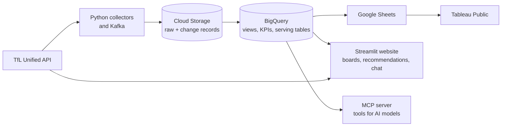

# London Transport Live Data Platform

An end-to-end data platform built on the [Transport for London Unified API](https://api.tfl.gov.uk/).
It collects live data on London's Tube, buses, Santander Cycles and main roads, keeps a permanent
history that TfL's API doesn't and turns it into dashboards, business recommendations and a chat
assistant that answers questions with charts and statistics.

**[See it live](https://joeldataportfolio.streamlit.app/~/+/transport_for_london)** ·
[Tableau dashboards](https://public.tableau.com/views/Transport_for_london/LineReliabilityDashboard) ·
Runs 24/7 on Google Cloud's free tier

---

## In 30 seconds

| | |
|---|---|
| **The problem** | TfL publishes live data, but it disappears once it changes. Nothing shows how reliable the network was last week. |
| **What I built** | Collectors that run around the clock, a cloud data lake and warehouse, live boards, four Tableau dashboards, data-driven recommendations and an "Ask the data" assistant. |
| **Scale** | Rail status every 30 s, Tube, tram and 12 bus routes' arrivals every 15 s (Kafka), all 675 bus routes every 30 min, ~800 bike stations every 2 min, 24 main roads every 5 min. |
| **Cost** | $0 a month: one free-tier VM (1 GB RAM) with memory caps, change-only storage and heavy jobs moved to serverless. |
| **Quality** | 274 automated tests, 19 data-quality rules, crash-safe storage with checksums, secrets never in code. |

## What it found (late October 2026)

- **Rail:** lines ran a good service 64% of the time. Planned works caused 54% of disruption; of the rest,
  half came from train cancellations and faults, led by the Central, District and Victoria lines.
- **Buses:** uneven spacing ("bunching") adds about 0.8 minutes to the average wait, up to 71,000
  passenger-hours a day. A headway-control pilot on routes 29, 18, 38, 141 and N25 is recommended.
- **Bikes:** about 6% of docking stations are empty in the weekday peaks, but 21 stations fail again and
  again. Target rebalancing and repairs there instead of adding bikes everywhere.
- **Roads:** 8 of 24 main roads were rated seriously delayed at least half the time, all with roadworks.
  Traffic signal faults took the longest to clear (14 h 33 min).

Each recommendation is recalculated from the archive every day, with its limits stated.

## Skills shown

| Area | What's in this project |
|---|---|
| Data engineering | API discovery (84 endpoints tested), resilient Python collectors, Kafka streaming, Google Cloud Storage data lake, BigQuery warehouse, scheduled SQL, Cloud Run jobs |
| Data quality | Validation rules, change detection, coverage tracking, idempotent hourly batches with SHA-256 manifests |
| Analytics | SQL views and KPIs, Google Sheets exports, Tableau Public dashboards, business recommendations |
| Data science | Correlation and regression, permutation tests, bootstrap confidence intervals, anomaly detection, forecasting, time-series decomposition, k-means clustering, spatial autocorrelation (Moran's I) |
| AI | An MCP server exposing seven read-only tools to AI models, document search (RAG with BM25) and a free rule-based assistant that builds safe SQL from a fixed catalogue |
| Software practice | Automated tests, secrets in Secret Manager, systemd services, cost-aware cloud design |

## How it works



- **Hot path (now):** the website reads TfL live, with one shared call for all visitors.
- **Cold path (history):** collectors keep only what changes, BigQuery turns it into hourly and daily
  tables and an hourly scheduled query refreshes the website's serving tables.

## The "Ask the data" assistant

Ask in plain English on the website, for example *"Is there a relationship between road disruptions and
bus traffic?"* or *"Heatmap of bus bunching by hour and day of week"*. It picks the measures and the
dimension from the question, builds SQL from a fixed catalogue (never from the visitor's words), runs it
on BigQuery and draws the chart that suits the data, with the statistics explained. It also gives
travel and traffic tips worked out from the data. It is rule-based, so it costs nothing to run.

## Engineering notes

- **API discovery:** all 84 TfL operations catalogued; with endpoint-specific inputs 71 return data. The
  real refresh rate of each was measured to decide what to stream ([scripts/](scripts/), [reports/](reports/)).
- **Shared client:** retries with exponential backoff and jitter, honours `Retry-After`, error messages
  never contain the API key ([src/clients/tfl.py](src/clients/tfl.py)).
- **Collectors:** raw responses always kept; change records (`NEW_INCIDENT`, `UPDATE`, `RESOLVED`…) and
  per-poll coverage stored separately; crash-safe hourly gzip batches ([src/collectors/](src/collectors/)).
- **Streaming:** Tube and bus arrivals go through Kafka; a train or bus counts as arrived when its
  prediction disappears ([kafka/](kafka/)).
- **Findings about the source:** TfL's disruption "end date" is a rolling placeholder (request time plus
  3 hours), so durations are measured from observed changes. The feed can flap (Good → Severe → Good within
  a minute); the record stays faithful and smoothing happens in analysis.

## Repository layout

| Folder | Contents |
|---|---|
| `src/collectors/`, `kafka/` | Collectors and the Kafka producers and consumers |
| `src/clients/`, `src/storage/` | Shared TfL client, data-lake writers (local or Cloud Storage) |
| `src/validation/`, `src/deduplication/` | Data-quality rules and change detection |
| `analytics/` | BigQuery SQL: views, KPIs, recommendations and serving tables |
| `src/presentation/` | Boards, recommendations and the assistant, shared with the website |
| `src/agent/`, `src/mcp_server/` | AI tools, document search and the MCP server |
| `deploy/` | systemd services, Cloud Run jobs and setup scripts |
| `docs/` | Requirements, endpoint analysis cards and the glossary |
| `tests/` | Unit tests with recorded TfL responses |

## Run locally

```bash
python3 -m venv .venv
.venv/bin/pip install -r requirements.txt -r requirements-dev.txt
cp .env.example .env            # then set TFL_API_KEY (free key from api-portal.tfl.gov.uk)

.venv/bin/python -m pytest                                   # tests, no network needed
.venv/bin/streamlit run app/streamlit_app.py                 # live board
.venv/bin/python -m src.collectors.line_status --polls 3     # collect into data/lake/
```

## Security

API keys are never committed. Locally the key comes from `.env`; on Google Cloud from Secret Manager;
on Streamlit Community Cloud from the app's secrets. Every AI and chat tool is read-only.

Powered by TfL Open Data. Contains OS data © Crown copyright and database rights 2016 and Geomni UK Map
data © and database rights 2019.
